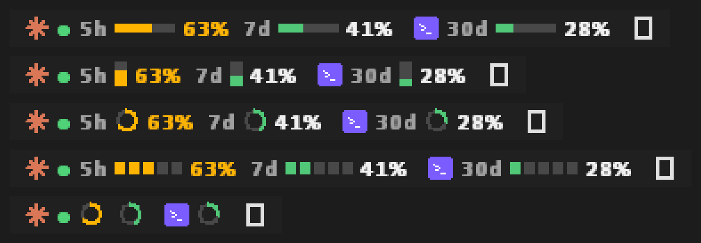
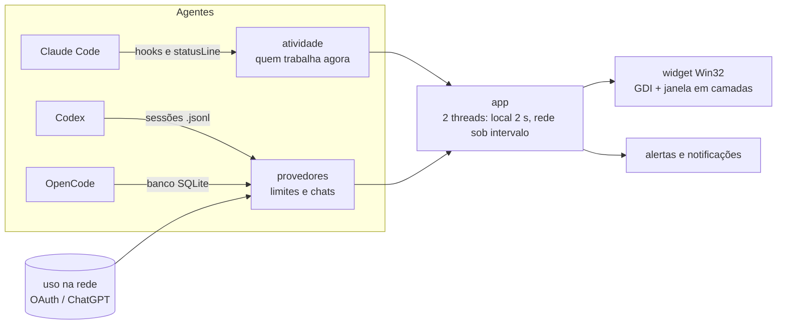

<div align="center">


# Line Quota

**Os limites do Claude Code, Codex e OpenCode sempre à vista, na barra de tarefas do Windows.**




<sub>O widget em quatro formatos: barra horizontal, vertical, círculo e blocos (a última linha, sem rótulos nem números).</sub>

</div>

---

## Por que usar

Quem usa agentes de código sabe: o limite acaba no meio de uma tarefa. O Line Quota fica ao lado do relógio, mostra
quanto já foi gasto de cada janela de uso e avisa **antes** de acabar. Sem janela de navegador, sem painel para
abrir, sem Electron: é um executável nativo de **2,9 MB**.

| | |
|---|---|
| 📊 **Limites reais** | Janelas de 5 horas e semanal do Claude Code e do Codex/OpenCode (ChatGPT). No Codex gratuito mostra o limite **mensal**. |
| 🟢 **O que cada agente faz** | Ponto verde quando trabalha, `?` quando espera você. Clique para abrir a árvore *Projeto → Chat → pedido atual*. |
| 🔔 **Avisos úteis** | Notificações do Windows ao passar de 80/90/95%, quando o limite renova, quando uma tarefa termina ou precisa de você. |
| 🎨 **Do seu jeito** | Barra horizontal, vertical, círculo ou blocos; com ou sem número; com ou sem rótulos; ícone, texto ou nada; fundo transparente; qualquer fonte. |
| 🪄 **Modo automático** | Mostra só o que está aberto e some quando nada está rodando. |
| 🔒 **Fica onde você pôs** | A posição vem travada: um clique sem querer não move o widget. |

## Veja

<table>
<tr>
<td align="center" width="50%"><b>Painel ao clicar no provedor</b><br><br></td>
<td align="center" width="50%"><b>Configurações</b><br><br></td>
</tr>
</table>

<sub>Imagens geradas pelo modo `--demo`, com dados fictícios.</sub>

## Instalar

1. Baixe o **`LineQuota-Setup-<versão>.exe`** na página de [Releases](../../releases) (ou gere com `scripts\package.ps1`, veja abaixo).
2. Dê dois cliques, escolha se quer iniciar com o Windows e clique em **Instalar**.

<div align="center">

</div>

- **Atualizar é o mesmo caminho:** rode o instalador novo por cima. Ele mostra *"Atualizar da versão X para Y"*, troca o programa e mantém suas configurações.
- **Sem administrador.** Instala em `%LOCALAPPDATA%\Programs\LineQuota`.
- **Nenhum agente é obrigatório.** Na primeira execução só ficam ligados os que existem no computador; o hook do Claude Code só é configurado se o Claude Code estiver instalado (com backup do seu `settings.json`).
- **Desinstalar:** *Configurações do Windows → Aplicativos instalados → Line Quota*. O desinstalador pergunta se deve apagar também as configurações (**purge**).

> **Aviso do SmartScreen:** o executável ainda não é assinado digitalmente, então o Windows pode mostrar "O Windows protegeu seu PC".
> Clique em *Mais informações → Executar assim mesmo*. O código é aberto e o `scriptspackage.ps1` imprime o SHA-256 do instalador para você conferir (`Get-FileHash`).

Para scripts: `LineQuota-Setup.exe` abre a janela; o programa instalado aceita
`line-quota.exe --install --quiet [--no-autostart] [--no-launch]` e `--uninstall [--quiet] [--purge]`.

## Em números

| | |
|---|---|
| Executável do app | **2,9 MB** (instalador: 3,2 MB, com o app dentro) |
| Memória em uso | **~21 MB** (set de trabalho), 7 MB privados |
| CPU parado | **~1%** de um núcleo (leitura local a cada 2 s; rede em outra thread) |
| Código | **~6 mil linhas** de Rust em 6 crates, **94 testes** automatizados |
| Dependências nativas | Win32 puro (GDI, sem frameworks de interface) |
| Chamadas de rede | Só `api.anthropic.com` (uso do Claude) e `chatgpt.com` (uso do Codex); sem telemetria |

## Como funciona



Cada crate faz uma coisa: `core` (modelos, config e alertas), `activity` (hooks do Claude e processos abertos),
`providers` (Claude, Codex, OpenCode), `ui` (desenho e configurações), `app` (orquestração e instalação) e `installer`
(esta janela de instalação, com o app embutido).

## Privacidade e segurança

- Os tokens do login do widget ficam **criptografados com DPAPI** do Windows, gravados de forma atômica; o login usa OAuth com PKCE e valida o `state`.
- O token do Codex só é enviado a endereços **HTTPS** (ou `localhost`); a URL do `config.toml` é validada.
- O hook que o Claude Code chama só lê arquivos `.jsonl` dentro da pasta do próprio Claude e sanitiza o nome dos arquivos que grava.
- Seu `settings.json` nunca é sobrescrito se não puder ser lido; o backup do original é feito uma única vez.
- Nada sai do computador além das duas consultas de uso acima.

## Desenvolvimento

```powershell
cargo test --workspace                                   # testes
cargo run -p line-quota                                  # widget
cargo run -p line-quota -- --demo                        # widget com dados fictícios (config temporária)
powershell -ExecutionPolicy Bypass -File scripts\package.ps1   # gera dist\LineQuota-Setup-<versão>.exe
```

O `package.ps1` compila o app, compila o instalador embutindo o app e grava o SHA-256 do resultado.

## Licença

[MIT](LICENSE).
