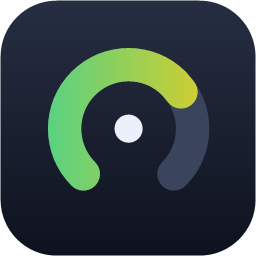
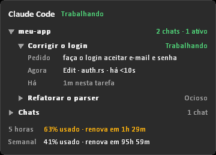
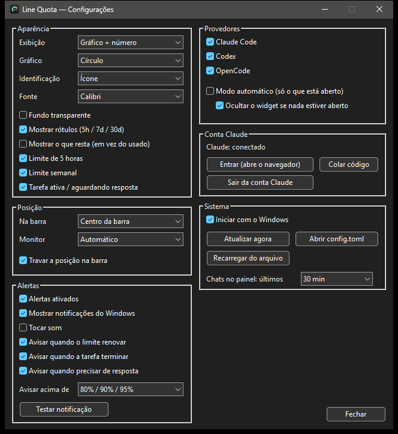
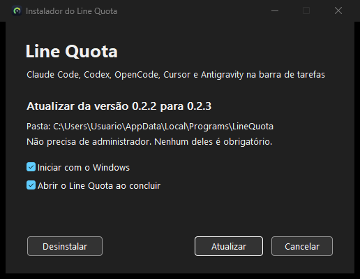
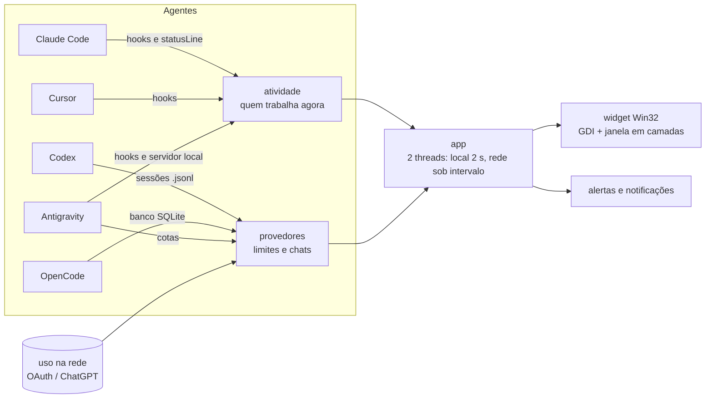

<div align="center">



# Line Quota

**Os limites do Claude Code, Codex, OpenCode e Antigravity sempre à vista, na barra de tarefas do Windows.**


<sub>O widget em quatro formatos: barra horizontal, vertical, círculo e blocos (a última linha, sem rótulos nem números).</sub>

</div>

---

## Por que usar

Quem usa agentes de código sabe: o limite acaba no meio de uma tarefa. O Line Quota fica ao lado do relógio, mostra
quanto já foi gasto de cada janela de uso e avisa **antes** de acabar. Sem janela de navegador, sem painel para
abrir, sem Electron: é um executável nativo de **3 MB**.

| | |
|---|---|
| 📊 **Limites reais** | Janelas de 5 horas e semanal do Claude Code e do Codex/OpenCode (ChatGPT). No Codex gratuito mostra o limite **mensal**. |
| 🟢 **O que cada agente faz** | Ponto verde quando trabalha, `?` quando espera você (ou, à escolha, uma linha colorida ao redor do ícone). Clique para abrir a árvore *Projeto → Chat → pedido atual*. |
| 🔔 **Avisos úteis** | Notificações do Windows ao passar de 80/90/95%, quando o limite renova, quando uma tarefa termina ou precisa de você. |
| 🎨 **Do seu jeito** | Barra horizontal, vertical, círculo ou blocos; com ou sem número; com ou sem rótulos; ícone, texto ou nada; fundo transparente; qualquer fonte. |
| 🪄 **Modo automático** | Mostra só o que está aberto e some quando nada está rodando. |
| 🌌 **Antigravity (experimental)** | Mostra a atividade (ponto verde) pelos hooks oficiais dele (`~/.gemini/config/hooks.json`) e as **cotas** (Gemini semanal; Claude e GPT em 5 h e semanal, como na tela de uso dele), num gráfico triplo: três barras lado a lado (ou blocos em fileiras) e, no círculo, três anéis concêntricos: o maior é o Gemini, o do meio o Claude/GPT semanal e o menor o Claude/GPT de 5 h (cada cota num tom de verde: Gemini mais escuro, Claude semanal normal, Claude 5 h mais claro, em qualquer formato). Em *Cotas do Antigravity* você escolhe quais mostrar e se ficam juntas ou separadas, em qualquer formato de gráfico: barras lado a lado e, no círculo, um anel dentro do outro. As cotas vêm do servidor local do próprio Antigravity (só `127.0.0.1`). Fica desligado até você ligar em *Configurações → Provedores* (ou ser encontrado na primeira execução). |
| 🧩 **Cursor (experimental)** | Mostra se o Cursor está trabalhando, pelos hooks oficiais dele. O **limite mensal** do plano aparece se você colar o cookie `WorkosCursorSessionToken` do painel (*Configurações → Provedores → Colar cookie*: abre o painel do Cursor, mostra o passo a passo com uma contagem de 3 minutos e detecta o cookie assim que você o copia); o Cursor não tem API oficial de uso nem login para apps de terceiros. Fica desligado até você ligar (ou ser encontrado na primeira execução). |
| 🔒 **Fica onde você pôs** | A posição vem travada: um clique sem querer não move o widget. |

## Veja

<table>
<tr>
<td align="center" width="50%"><b>Painel ao clicar no provedor</b><br><br></td>
<td align="center" width="50%"><b>Configurações</b><br><br></td>
</tr>
</table>

<sub>Imagens geradas pelo modo `--demo`, com dados fictícios.</sub>

## Instalar

1. Baixe o **`LineQuota-Setup-<versão>.exe`** na página de [Releases](../../releases) (ou gere com `scripts\package.ps1`, veja abaixo).
2. Dê dois cliques, escolha se quer iniciar com o Windows e clique em **Instalar**.

<div align="center">

</div>

- **Atualizar é o mesmo caminho:** rode o instalador novo por cima. Ele mostra *"Atualizar da versão X para Y"*, troca o programa e mantém suas configurações.
- **Sem administrador.** Instala em `%LOCALAPPDATA%\Programs\LineQuota`.
- **Nenhum agente é obrigatório.** Na primeira execução só ficam ligados os que existem no computador; os hooks do Claude Code, do Cursor e do Antigravity só são configurados se eles estiverem instalados, mesclados com os seus (com backup de `settings.json` e `hooks.json`). Se instalar o Cursor ou o Antigravity depois, rode o instalador de novo para configurar o hook dele.
- **Desinstalar:** *Configurações do Windows → Aplicativos instalados → Line Quota*. O desinstalador pergunta se deve apagar também as configurações (**purge**).

> **Aviso do SmartScreen:** o executável ainda não é assinado digitalmente, então o Windows pode mostrar "O Windows protegeu seu PC".
> Clique em *Mais informações → Executar assim mesmo*. O código é aberto e o `scripts\package.ps1` imprime o SHA-256 do instalador para você conferir (`Get-FileHash`).

Para scripts: `LineQuota-Setup.exe` abre a janela; o programa instalado aceita
`line-quota.exe --install --quiet [--no-autostart] [--no-launch]` e `--uninstall [--quiet] [--purge]`.

## Em números

| | |
|---|---|
| Executável do app | **3,0 MB** (instalador: 3,2 MB, com o app dentro) |
| Memória em uso | **~26 MB** (set de trabalho, até ~34 MB depois de uso), 7 MB privados; estável, sem vazamento de memória, handles ou objetos GDI |
| CPU parado | **~1%** de um núcleo (leitura local a cada 2 s; rede em outra thread) |
| Hooks | **~60 ms** por chamada (Claude Code, Cursor e Antigravity), sem abrir janela |
| Código | **~6 mil linhas** de Rust em 6 crates, **115 testes** automatizados |
| Dependências nativas | Win32 puro (GDI, sem frameworks de interface) |
| Chamadas de rede | Só `api.anthropic.com` (uso do Claude), `chatgpt.com` (uso do Codex) e `cursor.com` (uso do Cursor, só se você colar o cookie); o Antigravity é lido só localmente (`127.0.0.1`); sem telemetria |

## Como funciona



Cada crate faz uma coisa: `core` (modelos, config e alertas), `activity` (hooks do Claude, do Cursor e do Antigravity, e processos abertos),
`providers` (Claude, Codex, OpenCode, Cursor, Antigravity), `ui` (desenho e configurações), `app` (orquestração e instalação) e `installer`
(esta janela de instalação, com o app embutido).

## Privacidade e segurança

- Os tokens do login do widget ficam **criptografados com DPAPI** do Windows, gravados de forma atômica; o login usa OAuth com PKCE e valida o `state`.
- O token do Codex só é enviado a endereços **HTTPS** (ou `localhost`); a URL do `config.toml` é validada.
- O hook que o Claude Code chama só lê arquivos `.jsonl` dentro da pasta do próprio Claude e sanitiza o nome dos arquivos que grava.
- O hook do Cursor (`~/.cursor/hooks.json`) nunca bloqueia nada: responde sempre que pode seguir e só grava o estado (trabalhando/ocioso), o projeto e o último pedido, localmente.
- O hook do Antigravity também nunca bloqueia nada. Para as cotas, o app lê o arquivo de porta que o próprio Antigravity publica e consulta só `127.0.0.1`; o token desse arquivo nunca é gravado, mostrado nem enviado a outro endereço.
- Seu `settings.json` nunca é sobrescrito se não puder ser lido; o backup do original é feito uma única vez.
- O cookie do Cursor, se colado, fica criptografado com DPAPI (só o seu usuário do Windows abre), nunca aparece em tela, log ou configuração e só é enviado a `cursor.com` (sem seguir redirecionamentos). A área de transferência é limpa assim que ele é capturado; *Limpar* e a desinstalação o apagam. O histórico da área de transferência do Windows (Win+V), se ligado, pode guardar a cópia feita no navegador: apague o item ali.
- Nada sai do computador além das consultas de uso acima.

## Testes e verificações

Antes de cada versão: `cargo test --workspace` (**115 testes**), `cargo clippy` (sem erros) e uma bateria manual no programa real.

- **Entradas hostis:** os hooks recebem nomes de sessão com caminho (`../../x`), textos de 200 mil caracteres, JSON de tipo errado, lixo binário e 30 MB de entrada. Nada sai da pasta de atividade, os arquivos gravados ficam pequenos (textos cortados) e a leitura da entrada é limitada a 4 MiB.
- **Fuzz dos leitores:** todo leitor de resposta ou credencial (Claude, Codex, Cursor, Antigravity, cookie, login) é alimentado com amostras truncadas, com bytes trocados e com lixo aleatório; o `config.toml` também. Pode recusar, nunca trava.
- **Concorrência:** 60 hooks simultâneos na mesma sessão: o arquivo de estado é gravado de forma atômica e nenhuma leitura o viu pela metade.
- **Desempenho:** ~1% de CPU parado, ~26 MB, 6-7 threads, sem portas abertas; 36 ciclos de trabalhando/ocioso sem crescer memória, handles ou objetos GDI.
- **Segredos:** o cookie do Cursor só existe criptografado (DPAPI) e nenhum token aparece no código nem no histórico do Git; o token local do Antigravity é só lido para falar com `127.0.0.1`.
- **Binário:** ASLR, ASLR de alta entropia e DEP ligados.

## Desenvolvimento

```powershell
cargo test --workspace                                   # testes
cargo run -p line-quota                                  # widget
cargo run -p line-quota -- --demo                        # widget com dados fictícios (config temporária)
powershell -ExecutionPolicy Bypass -File scripts\package.ps1   # gera dist\LineQuota-Setup-<versão>.exe
```

O `package.ps1` compila o app, compila o instalador embutindo o app e grava o SHA-256 do resultado.

## Licença

[MIT](LICENSE).
